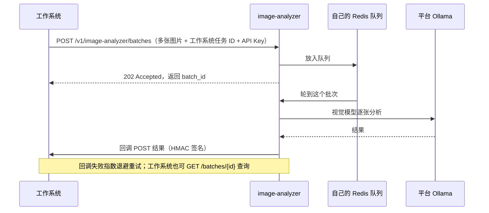

# 办公室 GPU 服务器 · Agent 平台规则（AGENT_PLATFORM）

> 适用于办公室服务器（RTX 5060，8GB 显存，WSL2 Ubuntu 24.04）上运行的**所有 agent**。
> 目前的 agent：**truth-mirror**（防诈 Discord 机器人）、**image-analyzer**（工作系统图片分析）。
> 相关文件：`SERVER_WINDOWS.md`（服务器设置）、`OFFICE_SERVER_ACCESS.md`（连接方式）、`TRAINING_LAB.md`（训练区）。

---

## 0. 给 agent 项目（Claude Code）的说明 · 动手前必读

**在写任何服务器端代码（compose、Dockerfile、部署脚本、模型调用）之前：**

1. 完整读本文件，特别是 **第 2 节（独立原则）**、**第 3 节（平台约定）**、**第 9 节（你这个项目的专属说明）**
2. 在自己的仓库根目录建立 **`agent.yaml`**（格式见第 7.1 节）
3. 对照本文件检查自己项目现有的规格与代码，**列出所有冲突之处，先问用户，不要自行决定**
4. 本文件与项目自己的规格冲突时，**服务器端相关的部分以本文件为准**（目录、GPU、网络、compose、密钥）；业务逻辑以项目规格为准
5. 本文件没写清楚的地方，先问，不要假设

---

## 1. 为什么需要管理

| 问题 | 不管理会怎样 |
|---|---|
| **GPU 只有一张、8GB**（可用约 7.5GB） | 多个模型同时加载 → 显存不足，请求失败或整台卡死 |
| 多个来源同时调用 | 没有排队就互相拖慢 |
| 数据混在一起 | 公司图片与社区举报混放，隐私与数据安全出问题 |
| 对外入口变多 | 每个 agent 自己开端口、自己做认证，迟早出漏洞 |
| 出问题找不到原因 | 不知道谁占满了 GPU |

---

## 2. 独立原则：一栋公寓大楼

| 大楼里的东西 | 对应到服务器 | 位置 |
|---|---|---|
| 每户独立的公寓 | 每个 agent | `~/agents/<名称>/` |
| 共用的水电（只有一套） | GPU、模型（Ollama）、入口网关 | `~/platform/` |
| 大楼管理规则 | 本文件 | — |
| 健身房（晚上才开） | 训练区 | `~/lab/` |

### 2.1 共用 vs 独立

| | 放在哪里 | 说明 |
|---|---|---|
| **模型 = 大脑**（共用） | `~/platform/ollama/` | 模型文件只存一份；GPU 只有一张，只能由平台统一加载 / 卸载 |
| **知识 = 笔记本**（独立） | `~/agents/<名称>/data/` | 知识库、数据库、上传文件、结果、自训练的小模型，**只属于这个 agent，其他 agent 看不到** |

### 2.2 每个 agent 独立拥有的东西

- 独立的**文件夹**：`~/agents/<名称>/`（就是该 agent 的 git 仓库 clone 下来的位置）
- 独立的**容器**与**内部 Docker 网络**
- 独立的**数据库 / 队列**（需要的话，自己在 compose 里起 PostgreSQL、Redis，**不与其他 agent 共用**）
- 独立的**密钥**：`~/agents/<名称>/.env`（`chmod 600`），**不同 agent 不共用任何 key**（包括 Claude API Key，各用各的，方便分开计费与撤销）
- 独立的**备份**与**回滚**

### 2.3 Agent 文件夹结构

```
~/agents/
├── _template/                 # 新 agent 的起始模板
├── truth-mirror/              # = truth-mirror 仓库的 clone
│   ├── agent.yaml             # 门牌：我是谁、用哪个模型、占多少显存（提交 git）
│   ├── compose.yml            # 怎么启动我（提交 git）
│   ├── .env.example           # 需要哪些环境变量（提交 git，不含真实值）
│   ├── .env                   # 真实密钥（gitignore，chmod 600）
│   ├── scripts/
│   │   ├── backup.sh          # 备份我自己的数据到 ~/backups/truth-mirror/
│   │   └── restore.sh
│   ├── src/ ...               # 程序代码
│   └── data/                  # 所有持久化数据（gitignore）
│       ├── db/                # 知识库：诈骗卡片、举报记录（PostgreSQL）
│       ├── uploads/           # 打码后的截图
│       └── models/            # 训练区训练好、批准上线的小模型
│
├── image-analyzer/            # = image-analyzer 仓库的 clone
│   ├── agent.yaml
│   ├── compose.yml
│   ├── .env.example
│   ├── .env
│   ├── scripts/backup.sh、restore.sh
│   ├── src/ ...
│   └── data/
│       ├── redis/             # 自己的任务队列
│       ├── inbox/             # 收到的工作图片（处理完即删除）
│       └── results/           # 分析结果（回调成功后按保留期限删除）
│
└── <未来 agent>/

~/platform/                    # 共用设施（不属于任何 agent）
├── compose.yml                # Ollama、监控、（之后）入口网关
├── registry.yaml              # 住户名册：所有 agent 的 agent.yaml 摘要
├── ollama/                    # 所有模型文件
├── state/                     # GPU 状态（agent 可只读挂载）
└── scripts/                   # gpu_acquire.sh、gpu_release.sh、gpu_status.sh

~/lab/                         # 训练区（见 TRAINING_LAB.md）
~/backups/<agent 名称>/        # 各 agent 的备份暂存
```

**一个 agent 出问题或要移除时，只处理它自己的文件夹，不影响任何其他 agent。**

---

## 3. 平台约定（agent 写代码时必须遵守）

### 3.1 平台提供的东西（固定名称，agent 直接使用）

| 名称 | 是什么 | agent 怎么用 |
|---|---|---|
| `platform-models` | Docker 外部网络 | 需要调用模型的容器加入这个网络 |
| `http://ollama:11434` | 共用模型服务 | 通过环境变量 `MODEL_BASE_URL` 取得，**代码里不写死** |
| `~/platform/state/gpu.json` | GPU 当前状态（是否训练中、已加载的模型） | 需要时**只读**挂载 |
| Tailscale `office-server` | 对外入口 | 见 3.5 |

> 之后若加入模型网关（如 LiteLLM），只需把 `MODEL_BASE_URL` 改指向网关，**agent 代码不需修改**。所以一律从环境变量读。

### 3.2 标准环境变量（每个 agent 的 `.env.example` 都要有）

| 变量 | 例子 | 说明 |
|---|---|---|
| `AGENT_NAME` | `image-analyzer` | 与 `agent.yaml` 的 name 一致 |
| `MODEL_BASE_URL` | `http://ollama:11434` | 模型服务地址 |
| `DATA_DIR` | `/data` | 容器内的数据目录，对应 `./data` |
| `LOG_LEVEL` | `info` | |
| 其他 | 各自的 Token、Key | 只放在自己的 `.env` |

### 3.3 调用模型的规则

- **只通过 `MODEL_BASE_URL` 调用**；容器**不得**使用 GPU（compose 中不得出现 `gpus`、`deploy.resources.reservations.devices`、`runtime: nvidia`）
- **不得**调用 Ollama 的管理 API（`/api/pull`、`/api/delete`、`/api/create`、`/api/copy`）；需要的模型写在 `agent.yaml`，由平台负责下载
- 每次请求都带上 `agent.yaml` 中设定的 `keep_alive`
- **不要假设模型已在显存中**：第一次请求可能要等模型加载（10–60 秒），超时时间要设足
- 遇到错误（503、队列满、超时）：指数退避重试；超过次数后按 `gpu_fallback` 设定处理（排队 / 改用 Claude API / 回报失败）
- 嵌入模型的名称与版本**一旦用来建立索引就不能随意更换**（换了要整个重建索引）

### 3.4 compose 规范（模板）

```yaml
name: image-analyzer                    # 必须等于 agent 名称

services:
  app:
    image: image-analyzer:1.0.0         # 锁定版本，不用 latest
    restart: unless-stopped
    user: "1000:1000"                   # 非 root
    read_only: true
    tmpfs: [/tmp]
    cap_drop: [ALL]
    security_opt: [no-new-privileges:true]
    mem_limit: 4g                       # 必须设上限，数值写进 agent.yaml
    cpus: 4
    env_file: .env
    environment:
      AGENT_NAME: image-analyzer
      MODEL_BASE_URL: http://ollama:11434
      DATA_DIR: /data
    volumes:
      - ./data/inbox:/data/inbox
      - ./data/results:/data/results
      - /home/toyoshimagtech/platform/state:/platform-state:ro   # 只在需要时挂载，且只读
    networks: [internal, platform-models]
    logging:
      driver: json-file
      options: { max-size: "10m", max-file: "3" }

  redis:                                # 自己的队列，不共用
    image: redis:7.4-alpine
    restart: unless-stopped
    volumes: [./data/redis:/data]
    networks: [internal]                # 不加入 platform-models
    mem_limit: 512m

networks:
  internal: {}
  platform-models:
    external: true
```

**禁止事项**：`privileged: true`、挂载 `/var/run/docker.sock`、挂载其他 agent 的文件夹、加入其他 agent 的网络、`network_mode: host`、把数据库端口发布到主机。

### 3.5 对外开放（只有需要被外部调用的 agent）

| 阶段 | 做法 |
|---|---|
| 入口网关建立前（staging） | 只绑定在 Tailscale 地址上：`ports: ["100.125.238.26:<分配端口>:8000"]`，应用本身验证 API Key |
| 入口网关建立后 | 移除 `ports`，改由网关（`office-server:8080`）转发 |

**端口分配表**（新 agent 申请时在此登记）：

| 端口 | 用途 |
|---|---|
| 22 | SSH |
| 8080 | 入口网关（规划中） |
| 8101 | image-analyzer（staging 期间） |
| 8102 起 | 未来 agent |
| — | truth-mirror：不对外开放（Discord 机器人只有出站连接） |

**绝不绑定 `0.0.0.0` 或 Windows 主机的公司网卡地址。**

### 3.6 数据规则

- 所有持久化数据只写在 `./data/` 下；容器其他位置只读
- 按 `agent.yaml` 的 `data_class` 与 `retention_days` 自动清理
- 日志用 JSON 输出到 stdout；**不记录图片内容、个人信息、密钥**
- 提供 `scripts/backup.sh` 与 `scripts/restore.sh`，备份输出到 `~/backups/<agent 名称>/`；数据库一律用 dump 备份，不直接复制数据文件

### 3.7 健康检查

- 提供 HTTP 服务的 agent：`GET /healthz`（检查自己的依赖：数据库、队列、模型服务是否可达）
- 不提供 HTTP 的 agent（如 Discord 机器人）：每 5 分钟向 Uptime Kuma 推送心跳

### 3.8 部署方式

```
家里电脑开发 → git push → ssh office → cd ~/agents/<名称> → git pull → docker compose up -d --build
```
- **不在服务器上直接改代码**
- 需要在服务器上用 GPU 测试时，用 staging：`~/agents/<名称>-staging/`，独立数据夹、独立 compose 名称、测试用的 key
- 部署前先跑一次 `scripts/backup.sh`

---

## 4. GPU 管理规则

### 4.1 显存预算（约 7.5GB 可用）

| 用途 | 模型（示例，4-bit 量化） | 显存 | 常驻？ |
|---|---|---|---|
| 嵌入模型（truth-mirror 检索） | bge-m3 | 约 1.2GB | **常驻** |
| 图片分析（image-analyzer） | 7B 级视觉模型（先与 3B 比较） | 约 5–6GB | 按需加载，处理完 5 分钟后卸载 |
| truth-mirror 分类 / 打码 / OCR | 3–4B 模型 | 约 2–3GB | 按需加载 |
| 训练 | — | 几乎全部 | 独占，只在夜间 |

**规则：除了常驻的嵌入模型，同一时间最多只有一个「大模型」在显存里。**

Ollama 设置（平台负责）：`OLLAMA_MAX_LOADED_MODELS=2`、`OLLAMA_NUM_PARALLEL=1`、设定 `OLLAMA_MAX_QUEUE`。

### 4.2 优先级

| 等级 | 谁 | 说明 |
|---|---|---|
| P0 | 平台、嵌入模型 | 永远保证可用 |
| **P1** | **image-analyzer** | 业务优先；约两周一次，来了就优先处理 |
| P2 | truth-mirror 本地模型任务 | 回答本身走 Claude API，不受影响；本地任务可短暂改用备援 |
| P3 | 批量任务、新闻摘要 | 可延后 |
| P4 | 训练 | 只在夜间；P1 任务到来时须让出 GPU |

### 4.3 训练与推理切换
- 训练前取得 GPU 锁（`~/platform/scripts/gpu_acquire.sh`），训练状态写入 `~/platform/state/gpu.json`
- 训练脚本必须支持 checkpoint 并监听停止信号
- P1 任务到来时：平台通知训练保存 checkpoint 并停止 → 最多等 5 分钟 → 让出 GPU → 批次完成后训练自动继续
- **在平台的抢占机制完成之前**：image-analyzer 读取 `gpu.json`，若训练中就排队等待，并在告警频道通知（因为约两周才一次，可以接受）

### 4.4 什么时候该加硬件
- 图片批次经常超过约定时限
- 两个以上 agent 需要 7B 以上模型且都要常驻
- 训练只能在夜间，已影响进度

---

## 5. 调用方式：同步 vs 异步

| 方式 | 适用 |
|---|---|
| 同步 | 几秒内完成（防诈问答、文字分类） |
| **异步** | 耗时长、需排队（**图片分析一律异步**） |



- **幂等**：同一个工作系统任务 ID 重复提交，不会重复分析
- **回调必须 HMAC 签名**
- 重试超过次数：标记失败并告警

---

## 6. 安全

### 6.1 数据分级

| 等级 | 例子 | 规则 |
|---|---|---|
| 公司数据 | 工作系统送来的图片 | 只在 image-analyzer 内处理；处理完即删除原图；**不送外部 API**；用于训练须另行决定（第 10 节） |
| 社区数据 | truth-mirror 用户举报 | 依 truth-mirror 的 `PROJECT_SPEC.md` 打码与保留规则 |
| 公开数据 | 新闻、公开资料 | 一般处理 |

### 6.2 网络（工作系统已在 tailnet 中）
- Tailscale 标签：`tag:gpu-server`（本服务器）、`tag:job-system`（工作系统）
- ACL 只开：`tag:job-system` → 本服务器的 image-analyzer 端口（之后改为网关 8080）；本服务器 → `tag:job-system` 的回调端口；你的电脑 → 本服务器 22
- 工作系统服务器在 Tailscale 后台要 **Disable key expiry**
- Tailscale 之外，**仍须验证 API Key、回调仍须 HMAC 签名**
- **不在路由器开端口**
- ⚠️ 修改 ACL 前确认 SSH 规则已包含，改完立刻测试 `ssh office`

ACL 示例（语法以 Tailscale 官方文档为准）：
```json
{
  "tagOwners": {
    "tag:gpu-server": ["autogroup:admin"],
    "tag:job-system": ["autogroup:admin"]
  },
  "grants": [
    { "src": ["tag:job-system"], "dst": ["tag:gpu-server"], "ip": ["tcp:8101", "tcp:8080"] },
    { "src": ["tag:gpu-server"], "dst": ["tag:job-system"], "ip": ["tcp:<回调端口>"] },
    { "src": ["autogroup:member"], "dst": ["tag:gpu-server"], "ip": ["tcp:22"] }
  ]
}
```

---

## 7. 新 agent 上线规则

### 7.1 登记表 `agent.yaml`（放在 agent 仓库根目录）

```yaml
name: image-analyzer              # 小写英文加连字号，等于文件夹名与 compose name
description: 分析工作系统上传的图片，回传结构化结果
owner: jhihli
status: staging                   # staging / production / retired

# 资源
models:
  - name: qwen2.5vl:7b            # 实际名称以 Ollama 库为准；由平台下载
    vram_gb: 6
    resident: false
    keep_alive: 5m
priority: P1                      # P0–P4，见 4.2
preempts_training: true
gpu_fallback: queue               # queue / claude / reject
claude_budget_usd_per_day: 0      # 0 = 不使用 Claude API
container_limits:
  memory: 4g
  cpus: 4
usage_pattern: "约每两周一次，批次提交"

# 调用
mode: async                       # sync / async
callers: [job-system]
port: 8101                        # 不对外开放填 null
endpoints:
  - POST /v1/image-analyzer/batches
  - GET  /v1/image-analyzer/batches/{id}
health: GET /healthz
sla_minutes: 30

# 数据
data_class: company               # company / community / public
retention_days: 0                 # 0 = 处理完即删除
use_for_training: false

# 运维
backup: scripts/backup.sh
alerts_to: "#系统告警"
rollback: "改回上一个镜像标签后 docker compose up -d"
```

### 7.2 上线检查清单

**设计**
- [ ] `agent.yaml` 填好，并登记到 `~/platform/registry.yaml`
- [ ] 显存检查：加上它之后，P0 + 最大 P1 同时需要的显存 ≤ 7.5GB
- [ ] 同步或异步已决定
- [ ] 数据等级、保留期限、能否用于训练已决定
- [ ] 若需对外开放：已在 3.5 节端口表登记

**开发**
- [ ] 文件夹结构符合 2.3 节；compose 符合 3.4 节（含禁止事项）
- [ ] 只通过 `MODEL_BASE_URL` 调用模型，符合 3.3 节
- [ ] `/healthz` 或心跳
- [ ] JSON 日志，不含图片内容、个人信息、密钥
- [ ] 输入检查：文件类型、大小、尺寸上限
- [ ] `backup.sh`、`restore.sh`
- [ ] 测试通过

**上线前**
- [ ] 平台已下载 `agent.yaml` 中的模型
- [ ] 建立调用方 API Key（与回调用的 HMAC 密钥）
- [ ] **压力测试**：真实大小输入连续送 50 个，同时其他 agent 正常运作，记录排队时间与显存峰值
- [ ] 测试「训练中」情境
- [ ] Uptime Kuma 健康检查
- [ ] 备份与还原实际演练一次
- [ ] 回滚演练一次
- [ ] `status: production`，更新 `registry.yaml`

**下线**
- [ ] 撤销所有 key
- [ ] 按保留规定删除数据
- [ ] 停止并移除容器；平台删除不再使用的模型
- [ ] `registry.yaml` 标记 retired，端口表释放端口

---

## 8. 监控（平台负责）

每日摘要：各 agent 请求数 / 失败数 / 处理时间；GPU 显存峰值与模型加载次数；最长排队时间；各 agent 的 Claude 花费；训练执行情况。

---

## 9. 两个项目的专属说明

### 9.1 truth-mirror（防诈 Discord 机器人）

**与 `PROJECT_SPEC.md` 的差异（服务器端以本文件为准）：**

| PROJECT_SPEC.md 原内容 | 改为 |
|---|---|
| compose 里自带 `ollama` 服务（第 2、3 节） | **移除**；改为加入 `platform-models` 网络，用 `MODEL_BASE_URL` 调用平台的 Ollama |
| `data/ollama/` 目录（第 3、10 节） | **移除**；模型文件归平台管理 |
| MIGRATION.md「`ollama pull` 模型清单」 | 改为「模型写在 `agent.yaml`，由平台下载」 |
| 部署路径 `~/truth-mirror` 或 `~/services/truth-mirror` | **`~/agents/truth-mirror/`** |
| Ubuntu 服务账号 `truthmirror` | 目前所有 agent 由 `toyoshimagtech` 运行；隔离靠容器与文件夹 |
| n8n、Uptime Kuma 放在 truth-mirror 的 compose | **n8n 留在 truth-mirror**（属于它的业务流程）；**Uptime Kuma 移到平台**（监控全部 agent） |

**专属规则：**
- 优先级 **P2**；`gpu_fallback: claude`（本地分类 / 打码模型不可用时改用 Claude API 或规则备援，**机器人不能因此停摆**）
- 嵌入模型 `bge-m3` 为 P0 常驻，写在 `agent.yaml`；换嵌入模型必须重建全部索引
- 不对外开放端口（Discord 只有出站连接）；`port: null`
- 自己的 PostgreSQL（含 pgvector）放在 `data/db/`，不与其他 agent 共用
- 图片分析批次进行时（约两周一次，数分钟），本地 3–4B 模型会被卸载，必须能自动走备援
- `data_class: community`

### 9.2 image-analyzer（工作系统图片分析）

- 优先级 **P1**；`preempts_training: true`；`gpu_fallback: queue`
- **公司数据**：图片处理完立即删除；**不送 Claude 或任何外部 API**；`claude_budget_usd_per_day: 0`；`use_for_training: false`（除非第 10 节另有决定）
- **异步批次**：`POST /batches` 一次多张图片；回传 `batch_id`；完成后 HMAC 签名回调工作系统；以工作系统的任务 ID 做幂等
- 自己的 Redis 队列，`data/redis/`
- 视觉模型**不常驻**：`keep_alive: 5m`；批次第一张图要容忍 10–60 秒冷启动
- 先用测试图片比较 **3B 与 7B** 视觉模型的准确度与速度，结果记录在仓库 README，再决定 `agent.yaml` 的模型
- 输入检查：只接受图片（检查真实文件类型）、单张大小与尺寸上限、单批张数上限、去除 EXIF
- staging 期间绑定 `100.125.238.26:8101`，并验证 API Key；网关建立后改由网关转发
- 训练中收到批次：在平台抢占机制完成前，读取 `gpu.json` 排队等待并告警（见 4.3）
- `data_class: company`；`sla_minutes: 30`

---

## 10. 决策记录

| 日期 | 决策 | 决定人 |
|---|---|---|
| 2026-11-14 | image-analyzer 为 **P1 最高业务优先**；约两周一次，视觉模型不常驻 | jhihli |
| 2026-11-14 | 工作系统服务器已安装 Tailscale，以 Tailscale ACL + API Key + HMAC 回调连接 | jhihli |
| 2026-11-14 | 公司数据与个人项目共用此服务器：已由 IT 核准（jhihli 即 IT 负责人）；两类数据分开存放 | jhihli |
| 2026-11-14 | Agent 各自独立：独立文件夹、容器、数据库 / 队列、密钥；**模型与 GPU 由平台统一管理**，agent 不得直接使用 GPU | jhihli |
| 2026-11-14 | 队列与数据库**不共用**：每个 agent 自己起需要的 Redis / PostgreSQL | jhihli |
| 2026-11-16 | image-analyzer = 工作系统现有的「清单照片 → 草稿」读图功能，搬到本服务器成为独立 agent；平台（Docker、`~/platform` Ollama）由 Claude 建立 | jhihli |
| 2026-11-16 | image-analyzer 模型用 `qwen3-vl:8b-instruct`（实测结果见 image-analyzer README；未另测 3B） | jhihli |
| 2026-11-16 | 结果以 HMAC 签名回调送回工作系统（`http://100.127.43.5:8000/...`，经 Tailscale）；工作系统也可 `GET /tasks/{task_id}` 补查 | jhihli |
| 2026-11-16 | 平台与 agent 的 git 仓库暂放本服务器 `~/repos/*.git`（开发电脑 push、服务器 pull），之后可加 GitHub 远端 | Claude（待确认） |
| 待定 | 公司图片是否可用于训练 | — |
| 待定 | 公司图片是否允许送外部 API；目前默认**不允许** | — |

新增或变更决策时，在此表追加一行。
